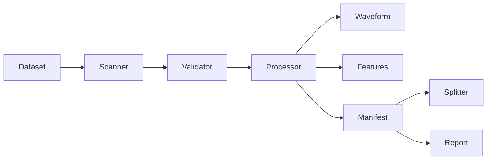

# Speech Data Toolkit

A reproducible, CPU-first audio preprocessing library and CLI for speech research. It scans datasets, validates WAV/FLAC recordings, prepares waveforms, extracts Mel and MFCC features, and writes portable manifests. No audio leaves your machine.

## Key features

- Recursive scanning with SHA-256, audio metadata, and errors for corrupted or unsupported discovered files.
- Polyphase resampling, stereo mean downmix, peak or RMS normalization, conservative edge trimming, and optional energy-based segmentation.
- VAD modes: `trim_edges` (default when enabled), `split`, and `concat`; original timeline intervals are recorded.
- Mel power, log-Mel, and MFCC arrays (`float32`, shape `frequency_or_coefficient × frames`) with JSON metadata.
- Atomic outputs, content and configuration based resume, bounded workers, JSONL and CSV processing manifests, JSON and HTML reports.
- Reproducible train/validation/test split, optionally speaker-disjoint.

## Installation

Python 3.11 or newer on Linux; CI currently checks 3.11. Install from a repository checkout with `pip` in a virtual environment:

```bash
python3 -m venv .venv
. .venv/bin/activate
python -m pip install .
speechprep --help
```

Alternatively, run `uv sync` and use `uv run speechprep`. Contributors can use `uv sync --extra dev` for the test and lint tools. To install a built wheel, run `uv build` followed by `python -m pip install dist/speech_data_toolkit-0.1.0-py3-none-any.whl`. The package has not been published to PyPI.

## Quick start

```bash
uv sync
uv run speechprep init --output config.yaml
uv run python examples/make_demo.py demo-audio
uv run speechprep scan demo-audio --output scan.jsonl
uv run speechprep validate demo-audio --report validation.json
uv run speechprep process demo-audio --config config.yaml --output processed
uv run speechprep features processed --type mfcc --output external-features
uv run speechprep split processed/manifest.jsonl --config config.yaml --output splits
uv run speechprep report processed --output report.html
```

`scan`, `validate`, and `process` exit with code 1 when files have errors; configuration or invocation errors use code 2. `process --dry-run` counts discovered files without writing outputs. `--workers`, `--fail-fast`, `--verbose`, and `--quiet` are available on `process`. Fail-fast writes a partial manifest and report with `stopped_early: true`; a later run resumes completed files.

## Python API

```python
from speech_data_toolkit import AudioProcessor

processor = AudioProcessor.from_config("config.yaml")
result = processor.process_file("demo-audio/speaker_01/utterance.wav", "processed")
print(result.output_path, result.original_duration, result.output_duration)
print(result.source_intervals)
```

Use `relative_path="speaker_01/utterance.wav"` when processing files directly and preserving a directory hierarchy. `process_dataset` provides the batch runner.

## Supported formats

Core input and output: WAV and FLAC via libsndfile/SoundFile. MP3, OGG, and M4A are discovered and reported as unsupported in this release. The original file is never overwritten. Output format and subtype are explicit in configuration. FLOAT output is only valid with WAV. Stereo downmix is the arithmetic mean of both channels. Peak normalization sets sample peak, not perceptual loudness.

Polyphase resampling can create peaks above full scale. When writing integer PCM, those samples are clipped and a manifest warning records the event; enable normalization or choose floating-point WAV output when that matters to the workflow.

## Configuration

Run `speechprep init --output config.yaml` for the full schema. Important defaults:

```yaml
schema_version: 1
audio:
  sample_rate: 16000
  channels: 1
  output_format: wav
  output_subtype: PCM_16
normalization:
  enabled: true
  method: peak
  target_peak_dbfs: -1.0
silence:
  enabled: false
  top_db: 40
  padding_ms: 150
vad:
  enabled: false
  backend: energy
  mode: trim_edges
features:
  enabled: true
  types: [mfcc, log_mel]
  n_mfcc: 40
  n_mels: 80
  n_fft: 400
  hop_length: 160
  win_length: 400
execution:
  workers: 1
  resume: true
  continue_on_error: true
```

Unknown keys and invalid ranges are rejected. Feature settings include `center` and `pad_mode` (`constant` zero padding or `reflect`); short centered inputs fall back to zero padding. Feature settings are independent of waveform processing; feature sample rate follows the decoded waveform for standalone `features`, and the configured output rate during `process`. Pipeline order: decode and validate → channels → resample → optional silence trim → optional energy VAD → optional normalization → write waveform → features. Energy activity estimates are not neural speech detection; use them conservatively, especially for quiet consonants. `trim_edges` retains internal pauses.

Validation thresholds are under `validation`. Speaker metadata can come from `dataset.speaker_directory_level` (zero is the first directory under the root) or `dataset.speaker_manifest`, a CSV/JSONL file with `source_path` and `speaker_id`. No speaker is inferred from a filename.

## Manifest and split

`processed/manifest.jsonl` and `processed/manifest.csv` have one record per source file. Required fields include `source_path`, `processing_status`, `configuration_fingerprint`, and `source_sha256` for successful jobs. Successful records include `output_path`, `output_paths`, original/output sample rates and durations, channel counts, `source_intervals`, applied steps, VAD segments, feature paths/shapes, warnings, and output size. Failure records include `error_message`. Paths are relative to the dataset or output root. In CSV, list and object fields are JSON strings.

```json
{"source_path":"speaker_01/utterance.wav","output_path":"speaker_01/utterance.wav","processing_status":"success","original_sample_rate":8000,"output_sample_rate":16000,"speaker_id":"speaker_01"}
```

Splits use `split.train`, `split.validation`, `split.test`, and `split.seed`. Set `split.speaker_disjoint: true` only when every record has a speaker ID. Split assignment is deterministic for the same manifest and seed. Recording-level splits can leak speaker or session information. Speaker-disjoint mode prevents speaker reuse across splits, but sessions shared by different speakers can still cross splits; this release has no session-grouping field. Ratios are approximate when groups have different sizes.

## Architecture



`audio.py` handles I/O and signal operations; `features.py` handles spectral features; `dataset.py` handles discovery, manifests, and splits; `pipeline.py` coordinates atomic processing and resume; `cli.py` exposes commands. The CLI calls the same library APIs.

## Testing and performance

Run `uv run pytest`, `uv run ruff check .`, `uv run ruff format --check .`, `uv run mypy src`, and `uv build`. Tests generate short deterministic audio locally. The JSON report records observed wall time, throughput, input/output duration, failure counts, warning count, output bytes, and feature file count. These are measurements of the current run, not a published benchmark.

On NixOS, native wheel imports may need `nix-ld` or a Nix environment that exposes C++ and zlib runtime libraries. The local verification used temporary `LD_LIBRARY_PATH` entries for those libraries.

Files are processed one at a time per worker in memory. The default input size limit is 256 MB and maximum duration is 1 hour; reduce `audio.max_file_mb` or `execution.workers` for low-memory systems. Cache verification hashes outputs on resume, trading I/O for integrity. Batch manifests are streamed; the `split` command loads its manifest in memory. Input symlinks are skipped during dataset discovery. Use a separate output tree.

The [synthetic comparison](docs/DEMO.md) records an actual 3.0-second input trimmed to 2.25 seconds, with its original timeline mapping.

## Limitations and roadmap

There is no neural VAD, speaker embedding model, compressed-format decoder, GPU path, or perceptual loudness normalization in v0.1. Future work may add optional, version-verified Silero/TorchCodec backends, session-grouped splitting, and streaming feature extraction. These require dedicated compatibility and quality tests.

## Contributing and license

See [CONTRIBUTING.md](CONTRIBUTING.md) for development checks and issue guidance. MIT license; see [LICENSE](LICENSE).
